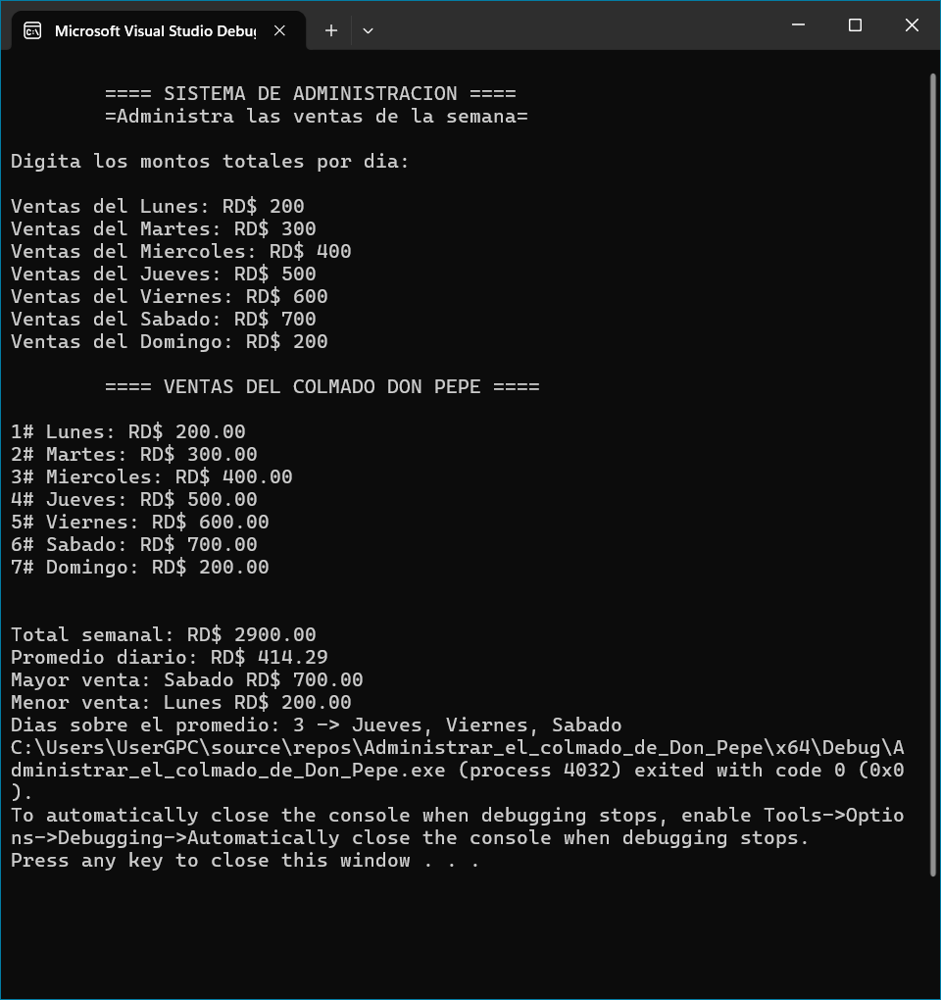
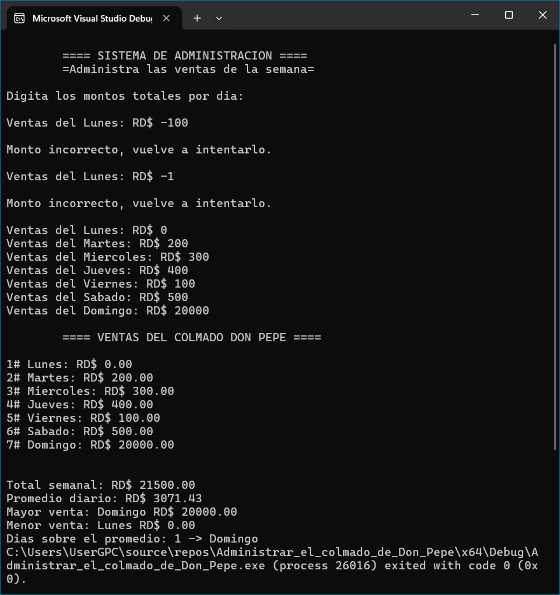

# Sistema de administración de ventas diarias

Programa de consola que registra y guarda en arreglos los datos digitados por el usuario para realizar un proceso que devuelve en la salida como reporte estadistico de un negocio.

## Datos del estudiante
- **Nombre:** Kelvin Alberto Santana Beltre.
- **Matrícula:** *[2025-2485]*.

## Descripción breve del programa

Sistema para registrar las ventas diarias de un negocio pequeño (como el colmado de "Don Pepe"), guardandolas en arreglos unidimensionales, 
recorriendolos con bucles y leyendo informacion para mantener variables de forma dinamica. Entregando como salida final un reporte estadistico semanal de las ventas diarias de dicho negocio.

## Lógica del programa

Administrar_el_colmado_de_Don_Pepe.cpp:

Entrada: leemos los valores del teclado del usuario,
7 montos de ventas diarias, no aceptamos los negativos.

Proceso:

- Almacenar las ventas en un arreglo unidimensional.
- Acumular el total semanal y calcular el promedio diario.
- Determinar el dia y monto de la mayor y menor venta.
- Guardar los dias que superaron el promedio.

Salida:
- Verificación del listado de ventas registradas en el sistema por dia.
- Resumen tipo estadistico: total semanal, promedio diario, mayor/menor venta y dias sobre el promedio.

## Captura de pantalla del programa en ejecución
### Ejemplo No.1 (Flujo normal del programa)

### Ejemplo No.2 (Validación de entradas positivas)

## Estructura utilizada y su función
Para este desarrollo utilicé **arreglos unidimensionales**, **ciclos repetitivos** y **estructuras condicionales**, dividiendo el flujo del programa en bloques secuenciales claros y respetando las restricciones de usar una constante fija (`DIAS = 7`), no emplear matrices ni `vector` y mantener todo el código en un único archivo:
- **Arreglos unidimensionales (`dias`, `ventas` y `dias_sobre_promedio`):** Los utilicé como estructura central de almacenamiento. Los dos primeros trabajan en paralelo compartiendo el mismo índice para vincular cada día con su monto de venta, mientras que el tercero actúa como arreglo auxiliar para guardar únicamente los nombres de los días que superaron el promedio.
- **Ciclos de recorrido (`for`):** Los implementé apoyados en la constante `DIAS` para iterar sobre las 7 posiciones en fases independientes: captura de datos, listado y acumulación semanal, búsqueda de extremos, filtrado sobre el promedio e impresión final.
- **Bucle de validación (`do-while` anidado):** Lo ubiqué dentro del `for` de entrada para garantizar que el monto de cada día se solicite al menos una vez y atrapar cualquier valor negativo (`ventas[i] < 0`), repitiendo la solicitud hasta recibir un dato válido.
- **Estructuras condicionales (`if` / `else if`):** Las utilicé para emitir avisos de error al validar, comparar cada monto contra el valor inicial del lunes para actualizar la mayor y menor venta junto a su día, filtrar qué días superan el promedio diario y controlar la impresión limpia de comas en el resumen final.
